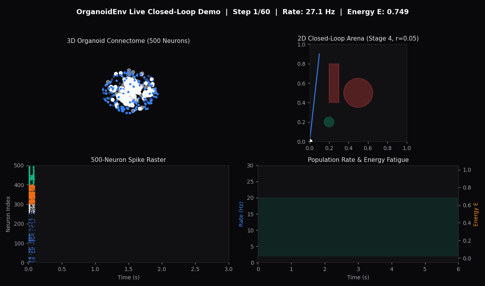

<p align="center">
  <h1 align="center">OrganoidEnv</h1>
  <p align="center">
    <strong>An Open, Ablatable Spiking Testbed for Studying Metabolic and Homeostatic Constraints in Organoid-Inspired Closed-Loop Reinforcement Learning</strong>
  </p>
  <p align="center">
    <a href="https://github.com/vansh7nvc/Organoid-Intelligence-gym-/actions/workflows/ci.yml"></a>
    <a href="https://colab.research.google.com/github/vansh7nvc/Organoid-Intelligence-gym-/blob/main/notebooks/colab_gpu_training.ipynb"></a>
    <a href="https://www.python.org/"></a>
    <a href="https://brian2.readthedocs.io/"></a>
    <a href="https://gymnasium.farama.org/"></a>
    <a href="https://pytorch.org/"></a>
    <a href="https://opensource.org/licenses/MIT"></a>
  </p>
</p>

---

## Live Closed-Loop Demo

<p align="center">
  
</p>

> **Watch full MP4**: [`docs/assets/organoidenv_demo.mp4`](docs/assets/organoidenv_demo.mp4) — Recorded directly from a live C99-accelerated Stage-4 episode (`100 ms` control steps), showing the **3D 500-neuron organoid connectome**, **2D obstacle arena**, **500-neuron spike raster**, and **population firing rate vs. normalized energy reserve $E(t)$**.

---

## Executive Summary

**OrganoidEnv** is a fast, reproducible, single-flag-ablatable Gymnasium testbed designed to study how cellular metabolic fatigue, homeostatic regulation, and multi-timescale three-factor plasticity shape closed-loop spiking reinforcement learning.

While modern deep reinforcement learning (RL) relies on unconstrained artificial activations and backpropagation, biological neural substrates operate under **non-differentiable spiking**, **energy-dependent fatigue ($E$)**, **Dale's E/I compartmentalization**, and **local eligibility-modulated plasticity**. `OrganoidEnv` bridges this gap with a native **C99 integration kernel** (`organoid_rl/environment/_snn_kernel.c`) numerically cross-checked against Brian2 ($|\Delta v| = 1.42 \times 10^{-14}\text{ mV}$, **$191.3\times$ speedup** over pure Brian2), enabling large-scale multi-seed ablations and real-time interactive visualization.

---

## Interactive 3D Web Workbench (`FastAPI` + `Three.js` + `Motion`)

OrganoidEnv ships with a real-time browser workbench (`organoid_rl/platform/`) for live experimentation, single-flag ablations, and dataset exploration:

```bash
pip install -e ".[platform]"
py -3.11 scripts/launch_platform.py --port 8000
```

* **3D Cortical Organoid Connectome (`Three.js` WebGL)**: Interactive 3D orbital view of all 500 neurons partitioned into Encoder Shell (`0–255`), Hidden Core (`256–299`), FS Inhibitory Ring (`300–399`), and 4 Cardinal Motor Lobes (`400–499`), flashing in real time via WebSocket (`/api/ws/sim`).
* **Live Single-Flag Ablation Controls**: Toggle Metabolic Fatigue ($E$), GAR Stabilizer, Three-Factor Plasticity, Dual-Trace, Structural Pruning, $\Delta_E$ slider, Curriculum Stages (`1–4`), and all 5 Obstacle Topologies (`T0–T4`) on the fly, or inject `+25` directional probes.
* **18-Condition Benchmark & Stability Explorers**: Inspect `rliable` IQMs with 95% bootstrap CIs, OOD generalization matrices, 4-regime phase-space heatmaps, and the 36-point biophysical sensitivity sweep.

---

## Key Architectural Modules

### 1. Energy-Constrained Izhikevich Neurons ($E$)
Neurons evolve in dimensionless Izhikevich units with an abstract energy-fatigue variable $E \in [-0.1, 1.0]$ inspired by $\mathrm{K}_{\mathrm{ATP}}$ channel dynamics:
$$\frac{dv}{dt} = \mathbb{I}[E>0]\!\left(0.04v^2 + 5v + 140 - u + I\right) + \mathbb{I}[E\le 0]\!\left(\frac{-80 - v}{0.5\text{ ms}}\right), \quad \frac{dE}{dt} = \frac{1 - E}{\tau_{\mathrm{rec}}}$$
Each spike ($v \ge 30$, $E > 0$) deducts $\Delta_E = 0.1$ ($\tau_{\mathrm{rec,exc}} = 1000\text{ ms}$, $\tau_{\mathrm{rec,inh}} = 500\text{ ms}$). This yields an **analytic asymptotic ceiling** on sustained population firing:
$$f_{\max} = \frac{1}{\Delta_E \tau_{\mathrm{rec}}} \implies 10.0\text{ Hz (Exc)}, \; 20.0\text{ Hz (Inh)}, \; 12.0\text{ Hz (Population-Weighted)}$$

### 2. Top-$k$ Sparse Expansion Encoder
Continuous $15\text{D}$ observations $\mathbf{s}_t$ project through a fixed random matrix $W \in \mathbb{R}^{256 \times 15}$ onto $256$ excitatory input channels; only the top-$k = 26$ channels ($\approx 10.2\%$) receive $+20.0$ depolarizing drive each $100\text{ ms}$ step.

### 3. Tri-State Global Activity Regulator (GAR)
Monitors total $100\text{ ms}$ population spikes $N_{\mathrm{recent}}$ across $500$ neurons:
* **Safety Reset**: Resets $v_i \leftarrow -65.0$, $E_i \leftarrow 1.0$ on numerical NaN/Inf.
* **Coma Kick ($N_{\mathrm{recent}} < 50$, $<1.0\text{ Hz}$)**: Injects stochastic current $5.0 \cdot \mathcal{U}(0, 1)$.
* **Seizure Clamp ($N_{\mathrm{recent}} > 5000$, $>100.0\text{ Hz}$)**: Silences $I_i \leftarrow 0$, clamps $v_i \leftarrow \min(v_i, -70.0)$, and potentiates feedback inhibition $+2.0$.

### 4. Presynaptic Dual-Trace Three-Factor Plasticity
Synapses maintain fast ($\tau_1 = 100\text{ ms}$) and slow ($\tau_2 = 2500\text{ ms}$) presynaptic eligibility traces modulated by scalar step reward $R_t$:
$$\Delta w_{ij} = \eta_{\mathrm{DA}} R_t \left(\mathrm{Trace1}_{ij} + 0.5\,\mathrm{Trace2}_{ij}\right)$$

---

## Empirical Results (`18` Conditions $\times$ `10` Equalized Seeds = `180` Runs / `90,000` Episodes)

All results below are computed from late-stage training (episodes `401–500`) using `rliable` Interquartile Means (IQM), 5,000-resample stratified bootstrap 95% CIs, and Benjamini–Hochberg FDR-corrected Mann–Whitney U tests (`results/benchmarks/summary_table.csv`).

| Condition | Return IQM [95% CI] | Goal Rate IQM | Rate (Hz) | Mean $E$ | $p_{\text{FDR}}$ vs C0 |
| :--- | :---: | :---: | :---: | :---: | :---: |
| **C0: Full Model (Reference)** | $-49.5\;[-81.5, -27.1]$ | $32.7\%$ | $6.51$ | $0.586$ | Reference |
| **C1: Frozen Weights** | $-6.0\;[-27.1, +11.3]$ | $53.7\%$ | $8.08$ | $0.468$ | $0.025$ |
| **C2: Random SNN** | $+14.7\;[+2.2, +36.4]$ | $63.0\%$ | $8.09$ | $0.479$ | $0.003$ |
| **C3: No Metabolism (GAR on)** | $-35.1\;[-82.2, -5.9]$ | $0.0\%$ | $17.41$ | $1.000$ | $0.567$ |
| **C4: No GAR** | $-43.7\;[-65.7, -12.8]$ | $38.3\%$ | $6.72$ | $0.575$ | $0.734$ (null) |
| **C5: No Pruning** | $-29.5\;[-55.4, -9.9]$ | $41.8\%$ | $7.18$ | $0.544$ | $0.362$ (null) |
| **C6: Single-Trace (50 ms)** | $-15.6\;[-37.3, +5.2]$ | $55.3\%$ | $8.17$ | $0.471$ | $0.051$ |
| **C6b: Single-Trace Fast (100 ms)** | $-0.2\;[-18.5, +15.8]$ | $55.3\%$ | $8.32$ | $0.468$ | $0.007$ |
| **C6c: Single-Trace Slow (2500 ms)** | $-76.5\;[-122.8, -30.6]$ | $24.7\%$ | $5.87$ | $0.633$ | $0.604$ |
| **C8: Unregulated (No GAR, No Met)** | $-45.2\;[-123.2, -11.8]$ | $0.0\%$ | $17.00$ | $1.000$ | $0.604$ |
| **B1b: Direct D3QN (`step 0.05`)** | $-32.1\;[-85.3, +30.3]$ | $26.3\%$ | — | — | $0.567$ |
| **B2b: MLP-DQN (`step 0.05`)** | $+71.5\;[+39.5, +87.3]$ | $41.7\%$ | — | — | $0.003$ |
| **B4b: PPO (`step 0.05`)** | $+59.2\;[+52.8, +71.8]$ | $56.2\%$ | — | — | $0.002$ |
| **B3: SimpleSNN (LIF)** | $-75.0\;[-83.5, -66.1]$ | $0.3\%$ | $65.06$ | $1.000$ | $0.160$ |
| **B5: Random Policy** | $-141.5\;[-142.8, -140.4]$ | $0.0\%$ | $4.60$ | $0.660$ | $0.007$ |

* **60-Second Long-Horizon Phase Sweep**: At extreme drive ($I_{\mathrm{stim}}=50, w_{\mathrm{inh}}=5$), unregulated networks sustain **$139.1\text{ Hz}$**, GAR alone oscillates at **$67.1\text{ Hz}$** ($200$ clamps / $200$ kicks), while metabolic fatigue relaxes smoothly to **$12.46\text{ Hz}$** (approaching the $12.0\text{ Hz}$ analytic ceiling).
* **Transparent Null & Negative Results**: Pruning (`C5`) and GAR (`C4`) are null under nominal drive (`0` seizure clamps across `55,000` spiking episodes); static/fast-trace SNNs match or beat `C0` in return; and rerunning silicon baselines at `step = 0.05` (`B1b/B2b/B4b`) resolves the earlier `step = 0.25` Stage-4/OOD collapse.

---

## Repository Structure

```
Organoid-Intelligence-gym-/
├── organoid_rl/
│   ├── environment/               # Core Gymnasium env, C99 kernel (_snn_kernel.c), GAR, neurons, rewards
│   ├── agents/                    # D3QN (NoisyNet + PER + HER), MLP-DQN, SB3 PPO, Random
│   ├── platform/                  # Interactive FastAPI + WebSocket server & Three.js + Motion UI
│   └── utils/                     # Deterministic 12-key seeding
├── scripts/
│   ├── launch_platform.py         # Launch interactive 3D workbench (http://127.0.0.1:8000)
│   ├── run_benchmarks_parallel.py # Parallel 18-condition multi-seed benchmark runner
│   ├── run_stability_sweep.py     # 4-mode 2D stability phase sweep
│   ├── run_revision_diagnostics.py# Clauset power-law GoF, 60s sweeps, ||dw|| & return logs
│   ├── analyze_benchmarks.py      # rliable IQM, bootstrap CIs, BH-FDR, lag-1 branching, Fano
│   ├── generate_figures.py        # All 13 publication vector figures (.pdf + .svg)
│   ├── generate_demo_video.py     # Generates docs/assets/organoidenv_demo.{gif,mp4}
│   └── verify_reproducibility.py  # Automated determinism & platform verification
├── results/benchmarks/            # 180-run CSVs, telemetry, sweeps, stats_summary.json
├── tests/                         # Stage 0–5, adversarial, and platform API test suites (85 tests)
├── docs/
│   ├── assets/                    # Demo GIF & MP4 video
│   ├── architecture_flow.mmd      # Architecture Mermaid source
│   └── architecture_flow.tex      # Architecture TikZ source
├── examples/                      # Standalone quickstart, evaluation, and ablation scripts
├── pyproject.toml                 # Package metadata, extras (dev, baselines, publication, platform)
└── README.md
```

---

## Quick Start & Reproducibility

### 1. Installation
```bash
git clone https://github.com/vansh7nvc/Organoid-Intelligence-gym-.git
cd Organoid-Intelligence-gym-
pip install -e ".[dev,platform]"
```

### 2. Launch the Interactive 3D Platform
```bash
py -3.11 scripts/launch_platform.py --port 8000
```

### 3. Python Gymnasium API
```python
from organoid_rl import OrganoidEnv

env = OrganoidEnv(
    use_metabolism=True,   # Energy-fatigue variable E with analytic rate ceiling
    use_stabilizer=True,   # Tri-state Global Activity Regulator (GAR)
    use_plasticity=True,   # Presynaptic dual-trace three-factor rule
    use_dual_trace=True,   # 100 ms + 2500 ms traces
    use_pruning=True,      # Periodic weak-weight pruning
    seed=42,
)
obs, info = env.reset(seed=42)
for _ in range(80):
    obs, reward, terminated, truncated, info = env.step(env.action_space.sample())
    if terminated or truncated:
        obs, info = env.reset(options={"preserve_weights": True})
```

### 4. Verification & Reproducibility Suite
```bash
# Run full test suite (Stages 0–5, adversarial, and platform API tests)
py -3.11 -m pytest tests/ -v

# Run end-to-end determinism, kernel & multi-session verification
py -3.11 scripts/verify_reproducibility.py
```

---

## Citation

```bibtex
@article{Sharma2026OrganoidEnv,
  author  = {Sharma, Vansh and Malik, Seema},
  title   = {OrganoidEnv: An Open, Ablatable Spiking Testbed for Studying Metabolic and Homeostatic Constraints in Organoid-Inspired Closed-Loop Reinforcement Learning},
  journal = {IEEE Transactions on Neural Networks and Learning Systems (Submitted)},
  year    = {2026}
}
```

## License
Distributed under the **MIT License**. See [`LICENSE`](LICENSE) for details.
