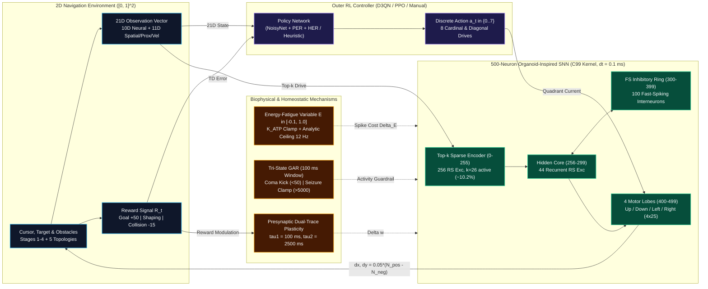

<p align="center">
  <h1 align="center">OrganoidEnv</h1>
  <p align="center">
    <strong>An Open, Ablatable Spiking Reinforcement Learning Testbed &amp; Interactive 3D Neural Workbench</strong>
  </p>
  <p align="center">
    <a href="https://github.com/vansh7nvc/Organoid-Intelligence-gym-/actions/workflows/ci.yml"></a>
    <a href="https://colab.research.google.com/github/vansh7nvc/Organoid-Intelligence-gym-/blob/main/notebooks/colab_gpu_training.ipynb"></a>
    <a href="https://www.python.org/"></a>
    <a href="https://brian2.readthedocs.io/"></a>
    <a href="https://gymnasium.farama.org/"></a>
    <a href="https://pytorch.org/"></a>
    <a href="https://opensource.org/licenses/MIT"></a>
  </p>
</p>

---

## Live Closed-Loop Demo

<p align="center">
  
</p>

> **Full MP4 Recording**: [`docs/assets/organoidenv_demo.mp4`](docs/assets/organoidenv_demo.mp4) — Recorded from a live C99-accelerated Stage-4 closed-loop episode (`100 ms` control steps), showing the **3D 500-neuron connectome**, **2D obstacle arena**, **500-neuron spike raster**, and **population firing rate vs. energy reserve $E(t)$**.

---

## Overview

**OrganoidEnv** is a fast, reproducible, single-flag-ablatable Gymnasium environment for closed-loop spiking neural network (SNN) reinforcement learning. It couples a **500-neuron organoid-inspired recurrent spiking network** (80% excitatory / 20% inhibitory Dale's split) to a continuous 2D navigation arena, backed by a native **C99 integration kernel** (`organoid_rl/environment/_snn_kernel.c`) cross-checked against Brian2 ($|\Delta v| \le 1.42 \times 10^{-14}\text{ mV}$, **$191.3\times$ speedup** over pure Brian2) and a real-time **FastAPI + Three.js 3D Web Workbench**.

---

## System Architecture



---

## Environment Specification (`OrganoidEnv`)

### 1. Observation & Action Spaces
* **Observation Space (`Box(low=-1, high=2, shape=(21,), dtype=float32)`)**:
  * `obs[0:10]` — 10D normalized neural population firing-rate channels
  * `obs[10:12]` — Cursor coordinates `(x, y)` in `[0, 1]^2`
  * `obs[12:14]` — Active target coordinates `(tx, ty)`
  * `obs[14]` — Context / active target index (`0` or `1`)
  * `obs[15:19]` — 4D obstacle proximity sensors (North, South, West, East)
  * `obs[19:21]` — Cursor velocity `(vx, vy)`
* **Action Space (`Discrete(8)`)**:
  * `0: Up`, `1: Down`, `2: Left`, `3: Right`, `4: Up-Right`, `5: Up-Left`, `6: Down-Right`, `7: Down-Left`.
  * Each action stimulates the corresponding motor quadrants; net cursor displacement is driven by motor spike counts: $\Delta x = 0.05\,(N_{\mathrm{right}} - N_{\mathrm{left}})$, $\Delta y = 0.05\,(N_{\mathrm{up}} - N_{\mathrm{down}})$.

### 2. 500-Neuron Compartmental Anatomy
| Compartment | Indices | Count | Neuron Type | Role |
| :--- | :---: | :---: | :--- | :--- |
| **Sparse Encoder** | `0–255` | `256` | Regular-Spiking (RS) Exc | Top-$k$ ($k=26$, $\approx 10.2\%$ active) sensory expansion |
| **Hidden Core** | `256–299` | `44` | Regular-Spiking (RS) Exc | Recurrent state integration |
| **Inhibitory Ring** | `300–399` | `100` | Fast-Spiking (FS) Inh | Recurrent E/I feedback inhibition |
| **Motor Quadrants** | `400–499` | `100` | Regular-Spiking (RS) Exc | `4 x 25` readout clusters (`Up`, `Down`, `Left`, `Right`) |

### 3. Curriculum Stages & Obstacle Topologies
* **Stage 1**: Open arena, `goal_radius = 0.15`
* **Stage 2**: Static circular (`pos=[0.5, 0.5], r=0.15`) and rectangular (`[0.2, 0.3, 0.4, 0.8]`) obstacles, `goal_radius = 0.10`
* **Stage 3**: Dual-target context switching (`[0.8, 0.8]` / `[0.2, 0.2]`), `goal_radius = 0.10`
* **Stage 4**: Full-precision navigation, `goal_radius = 0.05` (plus 5 evaluation topologies `T0_nominal` through `T4_tight_corridor`)

### 4. Reward Shaping
* **Goal Reached (`dist < goal_radius`)**: `+50.0` (proximity shaping: `+5.0` if `< 0.15`, `+1.0` if `< 0.30`)
* **Potential-Based Progress**: `10.0 * (0.99 * (-dist) - (-prev_dist))`
* **Penalties**: `-0.05` per step, `-15.0` obstacle collision, `-3.0` arena wall contact
* **Exploration**: `+5.0` halfway waypoint bonus, `+0.5` per newly visited grid cell, `+1.0` near-obstacle clearance

---

## Core Biophysical & Control Mechanisms

1. **Energy-Constrained Izhikevich Neurons ($E$)**:
   $$\frac{dv}{dt} = \mathbb{I}[E>0]\!\left(0.04v^2 + 5v + 140 - u + I\right) + \mathbb{I}[E\le 0]\!\left(\frac{-80 - v}{0.5\text{ ms}}\right), \quad \frac{dE}{dt} = \frac{1 - E}{\tau_{\mathrm{rec}}}$$
   Each spike ($v \ge 30$, $E > 0$) deducts $\Delta_E = 0.1$ ($\tau_{\mathrm{rec,exc}} = 1000\text{ ms}$, $\tau_{\mathrm{rec,inh}} = 500\text{ ms}$), establishing an analytic steady-state ceiling $f_{\max} = 1/(\Delta_E \tau_{\mathrm{rec}})$ ($10.0\text{ Hz}$ Exc, $20.0\text{ Hz}$ Inh, $12.0\text{ Hz}$ population-weighted).
2. **Tri-State Global Activity Regulator (GAR)**:
   Monitors $100\text{ ms}$ population spikes $N_{\mathrm{recent}}$: NaN/Inf safety reset, Coma Kick ($N_{\mathrm{recent}} < 50$, $<1.0\text{ Hz}$) injecting $5.0\cdot\mathcal{U}(0,1)$, and Seizure Clamp ($N_{\mathrm{recent}} > 5000$, $>100.0\text{ Hz}$) silencing drive and potentiating feedback inhibition.
3. **Presynaptic Dual-Trace Three-Factor Plasticity**:
   $$\Delta w_{ij} = \eta_{\mathrm{DA}} R_t \left(\mathrm{Trace1}_{ij} + 0.5\,\mathrm{Trace2}_{ij}\right), \quad \tau_1 = 100\text{ ms}, \; \tau_2 = 2500\text{ ms}$$
4. **Native C99 Integration Kernel (`_snn_kernel.c`)**:
   Compiles automatically on Linux/Windows/macOS with lazy exponential trace decay, matching Brian2 subthreshold integration within $1.42 \times 10^{-14}\text{ mV}$ at $\sim 191\times$ speedup.

---

## Interactive 3D Web Workbench (`FastAPI` + `Three.js` + `Motion`)

Launch the browser-based **3D Organoid Workbench** (`organoid_rl/platform/`) for real-time closed-loop simulation, single-flag ablations, and dataset exploration:

```bash
pip install -e ".[platform]"
py -3.11 scripts/launch_platform.py --port 8000
```

* **3D Cortical Organoid Connectome (`Three.js` WebGL)**: Real-time 500-neuron 3D orbital visualization driven via WebSocket (`/api/ws/sim`) with `OrbitControls` and compartment spike flashes.
* **Live Single-Flag Ablation Controls**: Toggle `use_metabolism`, `use_stabilizer`, `use_plasticity`, `use_dual_trace`, `use_pruning`, $\Delta_E$ slider, curriculum stages (`1–4`), and all 5 topologies (`T0–T4`) on the fly, or inject `+25` directional probes.
* **Multi-Session Scalability**: Isolated per-user `SimulationSession` instances managed by a thread-safe `SessionManager` (`max_sessions=32`, TTL eviction) with non-blocking `asyncio.to_thread` stepping.

---

## Quick Start, Docker & Testing

### 1. Local Installation
```bash
git clone https://github.com/vansh7nvc/Organoid-Intelligence-gym-.git
cd Organoid-Intelligence-gym-
pip install -e ".[dev,platform]"
```

### 2. Python Gymnasium API
```python
from organoid_rl import OrganoidEnv

env = OrganoidEnv(
    use_metabolism=True,   # Energy-fatigue variable E
    use_stabilizer=True,   # Tri-state Global Activity Regulator (GAR)
    use_plasticity=True,   # Presynaptic dual-trace three-factor rule
    use_dual_trace=True,   # 100 ms + 2500 ms traces
    use_pruning=True,      # Periodic weak-weight pruning
    seed=42,
)
obs, info = env.reset(seed=42)
for _ in range(80):
    obs, reward, terminated, truncated, info = env.step(env.action_space.sample())
    if terminated or truncated:
        obs, info = env.reset(options={"preserve_weights": True})
```

### 3. Docker & Reproducibility Verification
```bash
# Run the interactive 3D platform in Docker (port 8000)
docker compose up platform

# Run full headless reproducibility & test verification in Docker
docker compose --profile verify run reproduce

# Or run locally:
py -3.11 -m pytest tests/ -v
py -3.11 scripts/verify_reproducibility.py
```

---

## Repository Structure

```
Organoid-Intelligence-gym-/
├── organoid_rl/
│   ├── environment/               # OrganoidEnv, C99 kernel (_snn_kernel.c), GAR, neurons, rewards
│   ├── agents/                    # D3QN (NoisyNet + PER + HER), MLP-DQN, SB3 PPO, Random
│   ├── platform/                  # Multi-session FastAPI + WebSocket server & Three.js + Motion UI
│   └── utils/                     # Deterministic 12-key seeding
├── scripts/
│   ├── launch_platform.py         # Launch interactive 3D workbench (http://127.0.0.1:8000)
│   ├── run_benchmarks_parallel.py # Parallel multi-seed benchmark & ablation runner
│   ├── run_stability_sweep.py     # 4-mode 2D stability phase sweep
│   ├── analyze_benchmarks.py      # Non-parametric IQM, bootstrap CIs, FDR, branching, Fano
│   ├── generate_demo_video.py     # Generates docs/assets/organoidenv_demo.{gif,mp4}
│   └── verify_reproducibility.py  # Determinism, C99 kernel & multi-session isolation checks
├── results/benchmarks/            # Cached benchmark CSVs, telemetry, sweeps, stats_summary.json
├── tests/                         # Unit, biophysical, adversarial, and platform API test suites
├── docs/
│   ├── assets/                    # Demo GIF & MP4 video
│   ├── architecture_flow.mmd      # Architecture Mermaid source
│   └── architecture_flow.tex      # Architecture TikZ source
├── examples/                      # Quickstart, evaluation, and ablation examples
├── Dockerfile & docker-compose.yml# Containerized platform & reproducible test runner
├── pyproject.toml                 # Package metadata & optional extras
└── README.md
```

---

## License
Distributed under the **MIT License**. See [`LICENSE`](LICENSE) for details.
